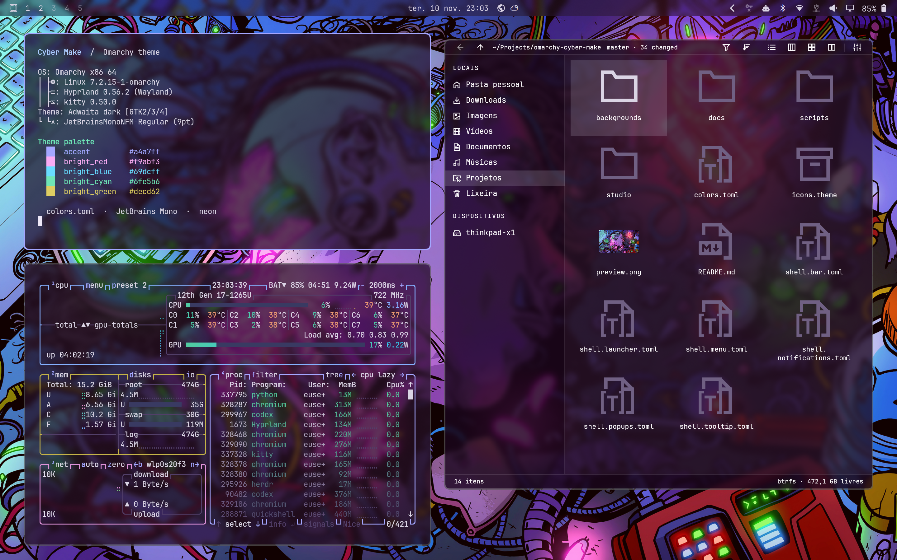
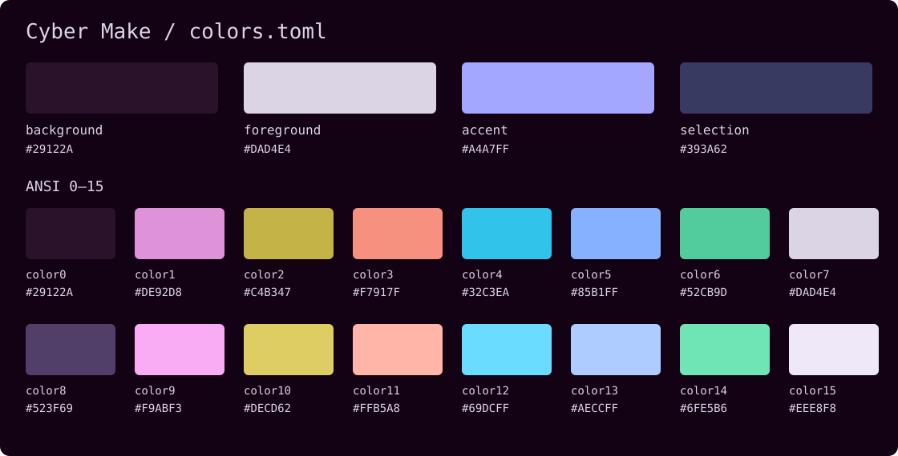
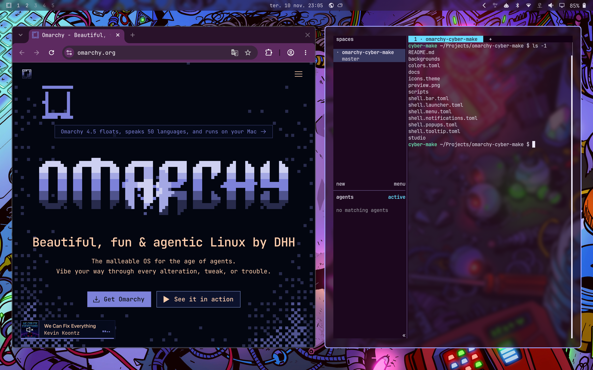

# Cyber Make — tema para Omarchy

Tema escuro com fundo roxo, destaque lavanda e cores neon. A paleta vem de
`colors.toml`; o Omarchy gera as configurações dos aplicativos ao aplicar o tema.





## Instalação

Requer Omarchy 4 com suporte a paletas semânticas e aos arquivos
`shell.<seção>.toml`. A estrutura foi validada com o Omarchy 4.5.0-3.

### Pelo repositório Git

```bash
omarchy theme install https://github.com/eusener/omarchy-cyber-make.git
```

O comando clona o repositório em `~/.config/omarchy/themes/` e já aplica o tema.
Para um repositório chamado `omarchy-cyber-make`, o nome instalado é
`cyber-make`. Para reaplicar ou voltar a ele depois:

```bash
omarchy theme set cyber-make
```

`theme set` recebe o nome de um tema disponível, não uma URL nem um caminho.
Se o repositório tiver outro nome, confira o nome instalado com
`omarchy theme list`.

### A partir desta cópia local

Na raiz deste projeto, registre a pasta como tema:

```bash
mkdir -p "$HOME/.config/omarchy/themes"
ln -s "$PWD" "$HOME/.config/omarchy/themes/cyber-make"
omarchy theme set cyber-make
```

O link exige que o destino `cyber-make` ainda não exista. Se já houver uma
instalação nesse caminho, preserve sua cópia antes de substituí-la.
Mantenha a pasta do projeto no mesmo lugar enquanto usar o link.

## Editor gráfico

O **Cyber Make Studio** permite editar a paleta, animações, cantos, bordas,
espaçamentos, opacidade, blur, sombras, papel de parede, ícones e o shell do
Omarchy. A prévia mostra o rascunho e **Aplicar tema** ativa a variante
`cyber-make-personal`.

A interface usa **JetBrains Mono**, fundos roxos e os tons neon da paleta.
As cores do editor e a prévia acompanham as alterações do rascunho.


### Instalar o Studio

Requer **Omarchy 4.5 ou superior**, **Hyprland 0.56 ou superior** e uma conta
com acesso ao `sudo` para instalar pacotes. Instale as ferramentas de compilação:

```bash
sudo pacman -S --needed base-devel git
```

Se ainda não tem uma cópia do repositório:

```bash
git clone https://github.com/eusener/omarchy-cyber-make.git
cd omarchy-cyber-make
```

Na raiz do projeto, execute:

```bash
studio/bin/install
```

O instalador usa `makepkg` para compilar e instalar um pacote Arch. As
dependências Qt 6, `tomlplusplus` e `ttf-jetbrains-mono` são instaladas quando
necessário. Execute o script como usuário normal; a instalação dos pacotes
solicita `sudo`.

Abra **Cyber Make Studio** no lançador do Omarchy (`Super + Espaço`) ou pelo terminal:

```bash
cyber-make-studio
```

O pacote inclui uma cópia do tema; o editor também reconhece a instalação em
`~/.config/omarchy/themes/cyber-make`. **Aplicar tema** cria e ativa
`cyber-make-personal`, mantendo o tema original disponível no seletor.

### Atualizar o Studio

Na pasta clonada do projeto:

```bash
git pull --ff-only
studio/bin/install
```

Feche e abra o Studio novamente depois da instalação.

### Executar a partir do código

Para compilar e abrir sem instalar o pacote:

```bash
sudo pacman -S --needed base-devel qt6-base qt6-declarative qt6-wayland tomlplusplus ttf-jetbrains-mono
studio/bin/build
studio/build/cyber-make-studio open --source .
```

Veja os [controles, atalhos e comandos do Studio](studio/README.md).

## O que o tema configura

| Arquivo | Função |
| --- | --- |
| `colors.toml` | Paleta semântica, cores ANSI e destaque das bordas |
| `shell.bar.toml` | Cores, transparência e dimensões da barra |
| `shell.launcher.toml` | Launcher e seleção |
| `shell.menu.toml` | Menus e seleção |
| `shell.notifications.toml` | Notificações |
| `shell.popups.toml` | Painéis e popups da barra |
| `shell.tooltip.toml` | Dicas de ferramentas |
| `icons.theme` | Nome do tema de ícones: `Yaru-blue` |
| `backgrounds/1-WALLPAPER00.jpg` | Wallpaper em 3840 × 2160 |
| `backgrounds/intros/1-WALLPAPER00.mp4` | Entrada animada de cerca de 5 segundos, em 1920 × 1078 e 30 fps |
| `scripts/generate-intro.sh` | Recria a entrada com FFmpeg a partir do JPG |
| `preview.png` | Prévia em 1280 × 720 |

Os arquivos `shell.*.toml` substituem apenas suas respectivas seções do
`shell.toml` gerado pelo Omarchy. As outras seções continuam usando os padrões
da versão instalada. As configurações de terminais, editores e outros aplicativos
são geradas pelos templates do próprio Omarchy.

O Omarchy restringe Lua e certas configurações executáveis em temas instalados
via Git. A instalação do tema usa a paleta e os arquivos TOML. Ajuste o
arredondamento, o blur e a opacidade pelo Studio ou siga o
[guia de personalização manual do Hyprland](docs/hyprland.md).

`Yaru-blue` precisa estar instalado para os ícones correspondentes aparecerem.
Instalar apenas o tema não instala pacotes nem muda a fonte. O Studio instala
suas próprias dependências, incluindo JetBrains Mono. Os nomes ANSI legados em
`colors.toml` foram preservados, mas a personalização do shell requer Omarchy 4;
não há garantia de compatibilidade completa com Omarchy 3.

## Uso e atualização

```bash
omarchy theme list
omarchy theme current
omarchy theme set cyber-make
omarchy theme bg next
```

Para atualizar uma instalação clonada via Git:

```bash
git -C "$HOME/.config/omarchy/themes/cyber-make" pull --ff-only
omarchy theme set cyber-make
```

Se usou um link para este projeto, atualize os arquivos aqui e reaplique o tema.
Preferências locais em `~/.config/omarchy/shell.toml` têm prioridade sobre as
cores e a transparência do shell definidas pelo tema.

### Entrada animada

O tema inclui um vídeo de abertura de aproximadamente 5 segundos, em
1920 × 1078 e 30 fps, reproduzido uma vez durante a entrada do wallpaper.

Requer uma versão do Omarchy com suporte a entradas de fundo pelo OWE.
Habilite as entradas depois de instalar ou atualizar o tema:

```bash
omarchy theme bg intro enable
```

A entrada toca ao iniciar a sessão com o tema ou ao trocar de outro tema para
o Cyber Make. Reaplicar o mesmo tema não dispara a entrada. As animações do
Hyprland também precisam estar habilitadas.

Para testar na sessão atual, depois de aplicar a versão atualizada do tema:

```bash
owe intro --start first-frame \
  "$HOME/.local/state/omarchy/current/theme/backgrounds/intros/1-WALLPAPER00.mp4"
```

O vídeo fica em `backgrounds/intros/` e tem o mesmo nome-base do JPG. Mantenha o
JPG como fundo selecionado: escolher um MP4 diretamente como wallpaper ativa
a reprodução contínua em vez da entrada.

Para gerar uma nova versão a partir do JPG, execute na raiz do projeto com
FFmpeg instalado. O script produz uma entrada de 6 segundos em 4K e 30 fps,
sem áudio, com zoom suave e quatro piscadas nas luzes neon. Ele substitui o
vídeo do projeto somente depois de concluir a geração:

```bash
bash scripts/generate-intro.sh
```

Para gerar uma prévia sem substituir o vídeo do projeto, passe outro caminho:

```bash
bash scripts/generate-intro.sh /tmp/cyber-make-intro.mp4
```

## Capturas de tela

Capturas reais do tema aplicado em uma sessão Omarchy com Hyprland.

### Terminal, Flea e btop

Terminal com informações do sistema e a paleta do tema, Flea aberto no
repositório e btop com os monitores de CPU, memória e rede.


### Navegador e Herdr

Navegador na página do Omarchy e Herdr em uma sessão dedicada ao projeto.



A [prévia do wallpaper](preview.png) e a [paleta](docs/images/palette.svg)
também estão disponíveis. Veja [como renovar as capturas](docs/screenshots.md).

## Referência

- [Omarchy](https://omarchy.org/)
- [Temas do Omarchy](https://omarchy.org/themes/)
- Ajuda local: `omarchy theme --help` e `omarchy capture screenshot --help`.
