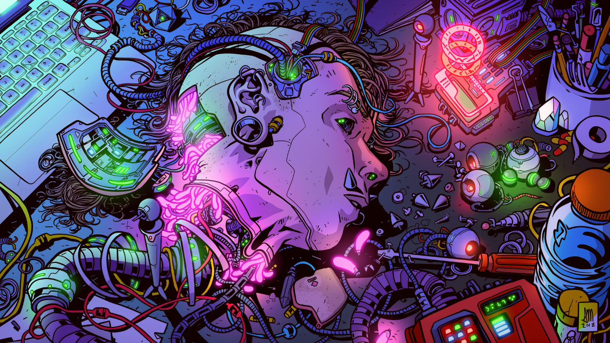

# Cyber Make — tema para Omarchy

Tema escuro com fundo roxo, destaque lavanda e cores neon. A paleta vem de
`colors.toml`; o Omarchy gera as configurações dos aplicativos ao aplicar o tema.



> A imagem acima é uma prévia do wallpaper, não uma captura do desktop.


## Instalação

Requer Omarchy 4 com suporte a paletas semânticas e aos arquivos
`shell.<seção>.toml`. A estrutura foi validada com o Omarchy 4.5.0-3.

### Pelo repositório Git

Depois de publicar este repositório, substitua `<URL_GIT_DESTE_REPOSITORIO>`
pela URL de clone dele:

```bash
omarchy theme install <URL_GIT_DESTE_REPOSITORIO>
```

O comando clona o repositório em `~/.config/omarchy/themes/` e já aplica o tema.
Para um repositório chamado `omarchy-cyber-make`, o nome instalado é
`cyber-make`. Para reaplicar ou voltar a ele depois:

```bash
omarchy theme set cyber-make
```

`theme set` recebe o nome de um tema disponível, não uma URL nem um caminho.
Se o repositório tiver outro nome, confira o nome instalado com
`omarchy theme list`.

### A partir desta cópia local

Na raiz deste projeto, registre a pasta como tema:

```bash
mkdir -p "$HOME/.config/omarchy/themes"
ln -s "$PWD" "$HOME/.config/omarchy/themes/cyber-make"
omarchy theme set cyber-make
```

O link exige que o destino `cyber-make` ainda não exista. Se já houver uma
instalação nesse caminho, preserve sua cópia antes de substituí-la.
Mantenha a pasta do projeto no mesmo lugar enquanto usar o link.

## O que o tema configura

| Arquivo | Função |
| --- | --- |
| `colors.toml` | Paleta semântica, cores ANSI e destaque das bordas |
| `shell.bar.toml` | Cores, transparência e dimensões da barra |
| `shell.launcher.toml` | Launcher e seleção |
| `shell.menu.toml` | Menus e seleção |
| `shell.notifications.toml` | Notificações |
| `shell.popups.toml` | Painéis e popups da barra |
| `shell.tooltip.toml` | Dicas de ferramentas |
| `icons.theme` | Nome do tema de ícones: `Yaru-blue` |
| `backgrounds/1-WALLPAPER00.jpg` | Wallpaper em 3840 × 2160 |
| `preview.png` | Prévia em 1280 × 720 |

Os arquivos `shell.*.toml` substituem apenas suas respectivas seções do
`shell.toml` gerado pelo Omarchy. As outras seções continuam usando os padrões
da versão instalada. As configurações de terminais, editores e outros aplicativos
são geradas pelos templates do próprio Omarchy.

O Omarchy restringe Lua e certas configurações executáveis em temas instalados
via Git. Por isso, o tema não depende de `hyprland.lua`, scripts de instalação
ou hooks. Arredondamento, blur e opacidade de janelas são ajustes locais
opcionais, descritos em [Personalização do Hyprland](docs/hyprland.md).

`Yaru-blue` precisa estar instalado para os ícones correspondentes aparecerem.
O tema não instala pacotes nem muda a fonte. Os nomes ANSI legados em
`colors.toml` foram preservados, mas a personalização do shell requer Omarchy 4;
não há garantia de compatibilidade completa com Omarchy 3.

## Uso e atualização

```bash
omarchy theme list
omarchy theme current
omarchy theme set cyber-make
omarchy theme bg next
```

Para atualizar uma instalação clonada via Git:

```bash
git -C "$HOME/.config/omarchy/themes/cyber-make" pull --ff-only
omarchy theme set cyber-make
```

Se usou um link para este projeto, atualize os arquivos aqui e reaplique o tema.
Preferências locais em `~/.config/omarchy/shell.toml` têm prioridade sobre as
cores e a transparência do shell definidas pelo tema.

## Capturas de tela

A prévia do wallpaper e a paleta estão incluídas acima. Prints reais do desktop
ainda precisam ser capturados em uma sessão gráfica: veja
[como capturar e adicionar os prints](docs/screenshots.md).

## Referência

- [Omarchy](https://omarchy.org/)
- [Temas do Omarchy](https://omarchy.org/themes/)
- Ajuda local: `omarchy theme --help` e `omarchy capture screenshot --help`.
