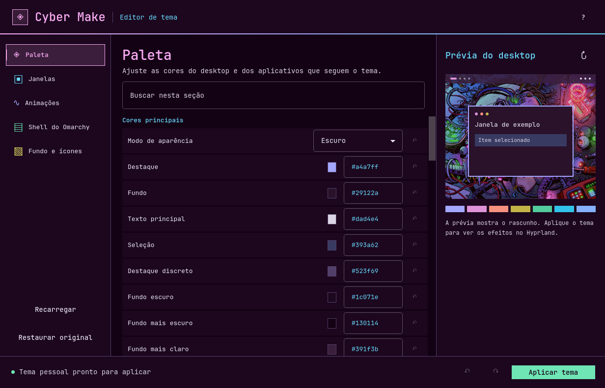

# Cyber Make Studio



Editor gráfico do tema Cyber Make para Omarchy 4.5 com Hyprland 0.56 e configuração em Lua.
A interface usa JetBrains Mono e os tons neon da paleta do tema, acompanhando os ajustes do rascunho.

## Instalar e abrir

Execute o instalador na raiz do repositório.

```bash
studio/bin/install
```

O script gera e instala um pacote Arch com o executável, o ícone e uma cópia
do tema. Abra **Cyber Make Studio** no lançador do Omarchy (`Super + Espaço`).

Com `base-devel`, `qt6-base`, `qt6-declarative`, `qt6-wayland` e
`tomlplusplus` disponíveis, use estes comandos para testar a partir do código.

```bash
studio/bin/build
studio/build/cyber-make-studio open --source .
```

Por padrão, o app usa o Cyber Make instalado em
`~/.config/omarchy/themes/cyber-make` quando encontra a paleta ali. O pacote
inclui uma cópia do tema para instalações que ainda não têm essa pasta.

## Personalizar

| Seção | Controles |
| --- | --- |
| Paleta | Modo claro ou escuro, cores semânticas e ANSI legadas, bordas ativas e inativas com gradientes |
| Janelas | Cantos, bordas, espaçamentos, opacidade, escurecimento, desfoque, sombras e brilho interno |
| Animações | Ativação, duração em décimos de segundo, curva e estilos por evento do Hyprland |
| Shell do Omarchy | Cores, transparência, bordas, espaçamento, tipografia e dimensões da barra, menus, lançador, notificações, painéis e outras superfícies |
| Fundo e ícones | Papéis de parede do tema ou da pasta pessoal, abertura animada e nome do tema de ícones instalado |

A prévia acompanha o rascunho. Use **Aplicar tema** para salvar e ativar
`cyber-make-personal`. Use a seta ao lado de um campo para herdar o padrão
novamente. **Restaurar original** limpa os ajustes do rascunho, que podem ser
aplicados depois da revisão. Se o Cyber Make original estiver instalado,
ele continua disponível no seletor do Omarchy.

Os espaços entre janelas e as margens aceitam uma, duas, três ou quatro
medidas, como `8`, `8 12` e `8 12 10 12`. Para bordas, experimente `accent`,
`#a4a7ff` ou `#a4a7ff #de92d8 45deg`. A transparência das superfícies
vai de 0 a 1. Para ver o desfoque na prévia, ative-o e reduza a opacidade
da janela ativa. Aplicativos com regras próprias de opacidade podem
combinar essas regras com a opacidade do tema.
[Opções do Hyprland](https://wiki.hypr.land/configuring/core/config-options/).

O Omarchy usa as preferências de `~/.config/omarchy/shell.toml` com prioridade
sobre as propriedades do tema. O controle de abertura animada determina se
a variante inclui o vídeo. A reprodução depende da opção de abertura do
Omarchy e das animações do Hyprland. Ao aplicar pelo Studio, o fundo
selecionado é atualizado diretamente. A abertura pode tocar ao trocar de
tema pelo Omarchy ou iniciar a sessão.

Use **Abrir pasta de fundos** para adicionar imagens ou vídeos à lista de
papéis de parede. Para vídeos, o Studio mostra uma imagem estática do tema
na prévia.

### Onde os ajustes são salvos

O app usa `~/.config/omarchy/themes/cyber-make-personal` para registrar a
variante e guarda o perfil em `~/.local/state/cyber-make-studio/revisions/`.
Na primeira aplicação de ajustes de janela ou animação, ele cria uma cópia
de segurança de `~/.config/hypr/hyprland.lua` e acrescenta um trecho que
carrega esses ajustes somente quando a variante está ativa. O editor valida
o Lua antes de ativar o tema, recarrega o Hyprland e verifica a configuração.
Em caso de falha ele tenta restaurar a revisão e o tema anteriores e mostra o
erro na interface.

Para voltar a uma instalação do Cyber Make original, escolha **Cyber Make**
no seletor do Omarchy ou use o comando abaixo.

```bash
omarchy theme set cyber-make
```

### Atalhos

| Teclas | Ação |
| --- | --- |
| Ctrl + Enter | Aplicar tema |
| Ctrl + Z / Ctrl + Shift + Z | Desfazer / refazer mudanças do rascunho |
| Ctrl + F | Buscar na seção |
| Ctrl + Q | Fechar |
| F1 | Mostrar atalhos |

## Linha de comando

```bash
cyber-make-studio check --json
cyber-make-studio export --output /tmp/cyber-make-exportado --json
cyber-make-studio apply --profile perfil.json --json
```

`check` valida os valores do perfil. `export` gera uma cópia em uma pasta
nova e valida o Lua de aparência. `apply` também ativa a variante e precisa
de uma sessão Hyprland. Com `--profile`, forneça um objeto JSON com os
ajustes. Este exemplo altera cinco propriedades.

```json
{
  "palette.accent": "#a4a7ff",
  "windows.decoration.rounding": 12,
  "windows.decoration.blur.enabled": true,
  "motion.windowsIn.speed": 3.8,
  "shell.bar.background-alpha": 0.85
}
```

Use `studio/bin/test` na raiz do repositório para compilar e rodar os testes
em pastas temporárias.
